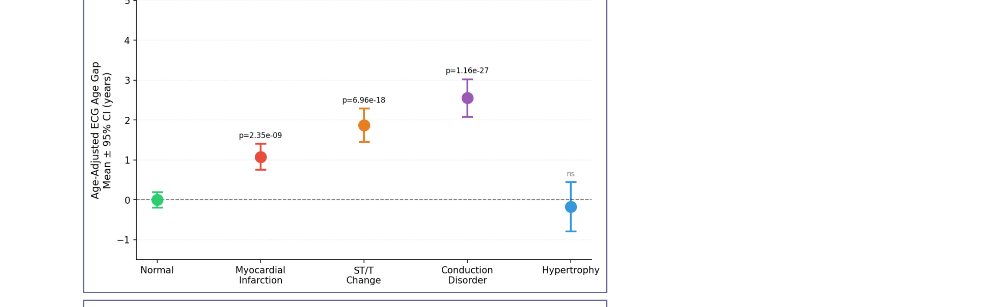
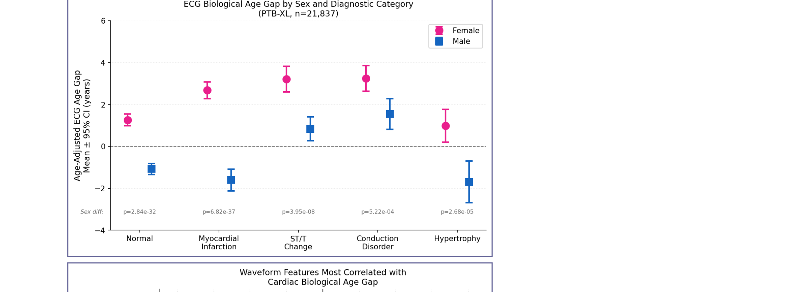
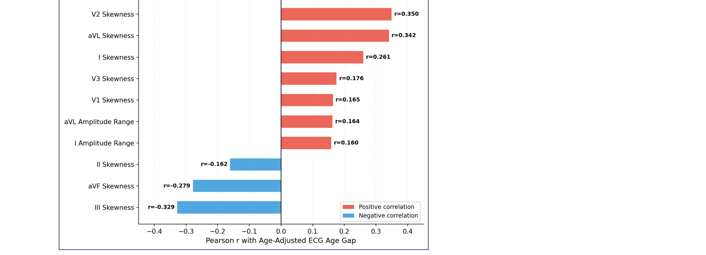

# Cardiac Biological Age Gap from 12-Lead ECG Using Deep Learning

[](https://python.org)
[](https://pytorch.org)
[](https://physionet.org/content/ptb-xl/1.0.3/)
[](LICENSE)

This repository contains the code for the abstract *A Deep Learning Approach to Quantifying Cardiac Biological Age Gap from 12-Lead Electrocardiography*, accepted at the American Heart Association (AHA) Scientific Sessions 2026 (Control #2026-A-15429-AHA).

## Overview

The cardiac biological age gap is the difference between the age a model predicts from a patient's 12-lead ECG and the patient's chronological age. Similar age-gap measures already exist for brain and retinal imaging. This project applies the same idea to cardiac electrophysiology, using the PTB-XL dataset.

Main findings:

- Conduction disorders, ST/T-wave changes and myocardial infarction showed significantly larger age-adjusted ECG age gaps than normal ECGs.
- Women had larger positive gaps than men in every pathological category.
- Lead skewness was the waveform feature most strongly correlated with the age gap (V2: r = 0.350; aVL: r = 0.342), ahead of amplitude-based features.

## Repository structure

```
cardiac-age-gap-deeplearning/
├── README.md
├── LICENSE
├── requirements.txt
├── src/
│   ├── data_loader.py        # PTB-XL loading and preprocessing
│   ├── model.py              # 1D ResNet architecture
│   ├── train.py              # Training loop
│   ├── inference.py          # Age gap computation on the full dataset
│   ├── age_adjustment.py     # Linear age adjustment of the gap
│   ├── analysis.py           # Statistical analyses (t-tests, Cohen's d)
│   └── waveform_features.py  # Per-lead feature extraction
├── figures/
│   ├── fig1_age_gap_by_category.png
│   ├── fig2_sex_stratified.png
│   └── fig3_waveform_correlations.png
└── results/
    └── summary_statistics.csv
```

The PTB-XL data is not included. See [Getting started](#getting-started) for download instructions.

## Methods

### Dataset

The study used PTB-XL from PhysioNet: 21,837 ten-second 12-lead ECGs sampled at 100 Hz. Mean age was 59.8 ± 17.0 years, and 52.2% of patients were female. Records fall into five diagnostic superclasses: normal (NORM, 9,522), myocardial infarction (MI, 5,403), ST/T-wave change (STTC, 2,807), conduction disorder (CD, 2,304) and hypertrophy (HYP, 1,309).

### Model

A one-dimensional residual network (ResNet) takes the raw 12-lead waveform (12 × 1000 samples) and predicts chronological age as a regression output. It was trained only on normal ECGs (n = 9,522, 80:20 train/validation split) with L1 loss. Validation mean absolute error was 10.44 years.

```
Input (12×1000)
    → Conv1d(12→32, k=7) + ReLU
    → ResBlock(32)
    → Conv1d(32→64, stride=2) + ReLU
    → ResBlock(64)
    → Conv1d(64→128, stride=2) + ReLU
    → AdaptiveAvgPool1d(1)
    → Linear(128→64) + ReLU + Dropout(0.3)
    → Linear(64→1)
```

### Age gap

```
ECG Age Gap      = Predicted Age − Chronological Age
Age-Adjusted Gap = Residual after regressing the gap on age in the normal cohort
```

The raw gap depends on chronological age, because predictions regress toward the mean. To correct for this, a linear model of gap against age is fitted on normal ECGs, and its residual is used for every subject.

### Statistical analysis

Each diagnostic category was compared with normal ECGs using independent-samples t-tests, with Cohen's d as the effect size. The same comparisons were repeated separately by sex. Pearson correlations were computed between per-lead waveform features and the age-adjusted gap.

## Results

### Age-adjusted ECG age gap by diagnostic category

| Category | n | Mean gap (years) | SD | p-value | Cohen's d |
|---|---|---|---|---|---|
| Normal (reference) | 9,522 | 0.00 | 9.67 | — | — |
| Conduction disorder | 2,304 | +2.55 | 11.53 | 1.16e-27 | 0.24 |
| ST/T-wave change | 2,807 | +1.87 | 11.35 | 6.96e-18 | 0.18 |
| Myocardial infarction | 5,403 | +1.08 | 12.08 | 2.35e-09 | 0.10 |
| Hypertrophy | 1,309 | −0.18 | 11.46 | 0.55 | 0.02 |

### Sex-stratified analysis

| Category | Female gap | Male gap | p-value |
|---|---|---|---|
| Myocardial infarction | +2.67 ± 12.00 | −1.61 ± 11.73 | 6.82e-37 |
| ST/T-wave change | +3.21 ± 10.82 | +0.84 ± 11.64 | 3.95e-08 |
| Conduction disorder | +3.24 ± 11.56 | +1.55 ± 11.42 | 5.22e-04 |
| Hypertrophy | +0.98 ± 10.90 | −1.70 ± 12.00 | 2.68e-05 |

### Waveform features most correlated with the gap

| Feature | Pearson r | p-value |
|---|---|---|
| V2 skewness | 0.350 | <0.001 |
| aVL skewness | 0.342 | <0.001 |
| III skewness | −0.329 | <0.001 |
| aVF skewness | −0.279 | <0.001 |
| I skewness | 0.261 | <0.001 |

## Figures

<p align="center">
  
  <br><em>Figure 1. Age-adjusted ECG biological age gap by diagnostic category.</em>
</p>

<p align="center">
  
  <br><em>Figure 2. Sex-stratified age gap across diagnostic categories.</em>
</p>

<p align="center">
  
  <br><em>Figure 3. Waveform features correlated with the cardiac biological age gap.</em>
</p>

## Getting started

Clone the repository and install the dependencies:

```bash
git clone https://github.com/thepavan17/cardiac-age-gap-deeplearning.git
cd cardiac-age-gap-deeplearning
pip install -r requirements.txt
```

Download PTB-XL from Kaggle or PhysioNet:

```bash
# Kaggle
kaggle datasets download -d khyeh0719/ptb-xl-dataset --unzip -p ./data

# PhysioNet
python -c "import wfdb; wfdb.dl_database('ptb-xl/1.0.3', './data')"
```

The scripts read the data from `./data/ptbxl` by default; use `--base_path` to point them elsewhere. Then train the model, compute the age gaps and run the analysis:

```bash
python src/train.py --epochs 30 --batch_size 64
python src/inference.py --model_path best_model.pt
python src/analysis.py
```

## Citation

If you use this code, please cite:

```bibtex
@abstract{paruchuri2026ecg,
  title     = {A Deep Learning Approach to Quantifying Cardiac Biological Age Gap from 12-Lead Electrocardiography},
  author    = {Paruchuri, Amith and Paruchuri, Riddhi},
  booktitle = {AHA Scientific Sessions 2026},
  year      = {2026},
  note      = {Control \#2026-A-15429-AHA}
}
```

## Authors

Amith Paruchuri, MBBS Intern, All India Institute of Medical Sciences (AIIMS), New Delhi; Remote Researcher, Madabhushi Lab, Emory University; Khorana Scholar, Harvard Medical School; Co-founder, Aterenex.

Riddhi Paruchuri, Ohio State University.

## Acknowledgements

The PTB-XL dataset was published by Wagner et al. (*Scientific Data*, 2020) and is hosted on PhysioNet. The approach follows earlier brain age gap (Cole et al.) and retinal age gap (Zhu et al.) studies.

## License

Released under the MIT License. See [LICENSE](LICENSE).
